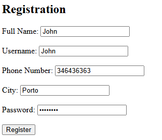
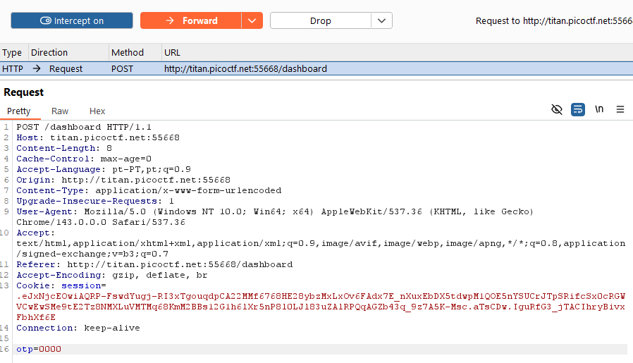

# 🚀 Web Exploitation IntroToBurp CyLab  
**Source:** CyLab  
**Category:** Web Exploitation  
**Difficulty:** Easy  
**Goal:** Find the hidden flag inside the code

---

## 🔎 Description / Context

This challenge tests your ability to intercept request to capture the flag.

---

## 🎯 Objective

Locate the **flag** hidden somewhere inside the webpage.

---

## ⚙️ Prerequisites

- Modern web browser (Chrome, Firefox, Edge)
- Basic knowledge of:
  - HTTPS
  - Burpsuite

---

## ▶️ Quick Steps / Approach

1. Open the challenge page.  
2. Open BurpSuite
3. Intercept requests.

---

## 🧭 Solution (SPOILER)

 Solution 

1. Open the CTF challenge IntroToBurp.   
2. You have to put something on all the inputs of the registration page 
 
3. Click Register 
4. Application will ask for OTP in the next page 
 
5. Provide any random value as OTP and click on the Submit which will show a message as “Invalid OTP”. 
6. Open the BurpSuite 
7. Use the Proxy and intercept the request 
 
8. Modify the request 
9. The flag was successfully retrieved.

## ❌ Common Mistakes

- Not intercepting requests

## ✅ What I Learned

- How to intercept requests using BurpSuite
